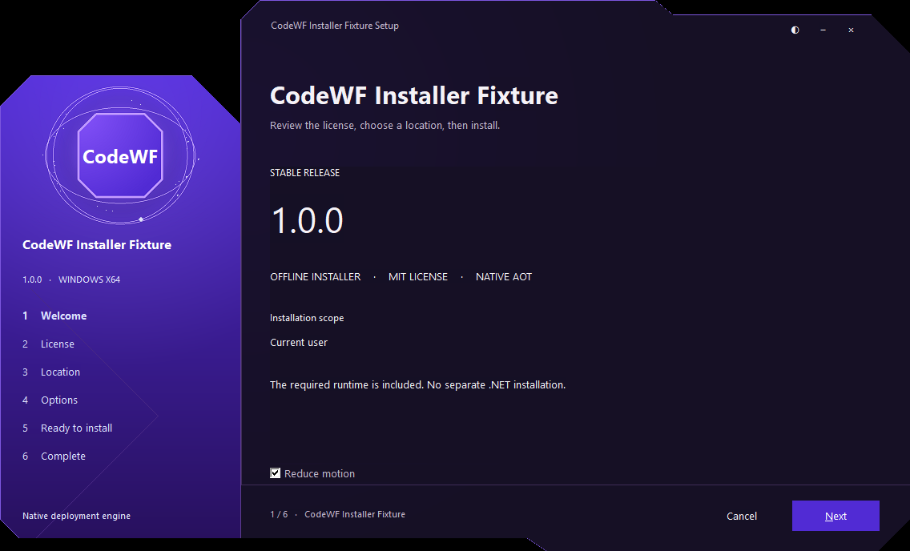
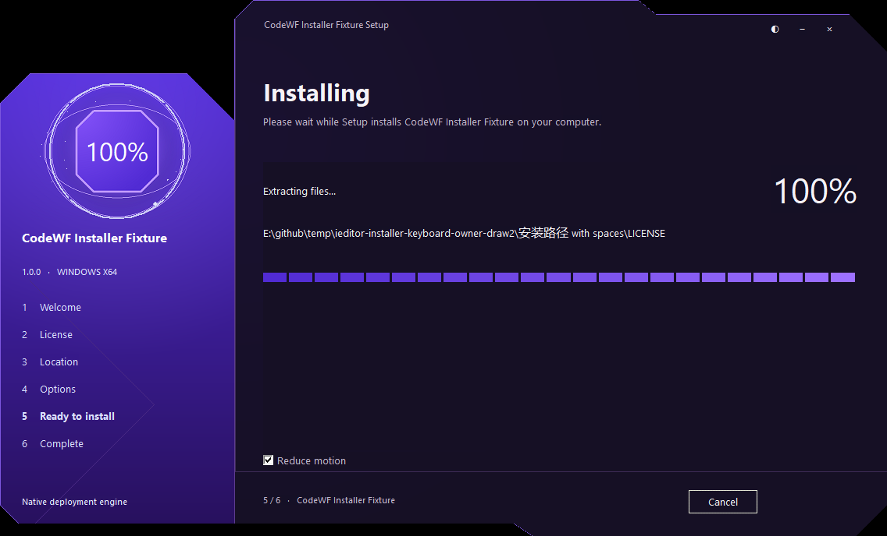

# 统一安装器实施与本机验证

2026-10-16，已确认的第二版原型应用于 11 个桌面 App 和两个库 Demo。所有仓库直接在 main 维护本地安装器快照，不读取相邻仓库。

## 交付与验证

| 产品 | 版本 | 本机 Windows 安装包 | 五平台下载 |
| --- | --- | --- | --- |
| AvaGithubDesktop | 0.118.0.19 | `AvaGithubDesktop-v0.118.0.19-win-x64-setup.exe` | [Release](https://github.com/dotnet9/AvaGithubDesktop/releases/tag/v0.118.0.19) |
| ClearC | 0.2.13 | `ClearC-v0.2.13-win-x64-setup.exe` | [Release](https://github.com/dotnet9/ClearC/releases/tag/v0.2.13) |
| CodeWF.Avalonia.Demo | 12.1.4.26 | `CodeWF.Avalonia.Demo-v12.1.4.26-win-x64-setup.exe` | [Release](https://github.com/dotnet9/CodeWF.Avalonia/releases/tag/v12.1.4.26) |
| CodeWF.Toolbox | 12.0.18 | `CodeWF.Toolbox-v12.0.18-win-x64-setup.exe` | [Release](https://github.com/dotnet9/CodeWF.Toolbox/releases/tag/v12.0.18) |
| CodeWF.Toolkit.Demo | 1.0.0.25 | `CodeWF.Toolkit.Demo-v1.0.0.25-win-x64-setup.exe` | [Release](https://github.com/dotnet9/CodeWF.Toolkit/releases/tag/v1.0.0.25) |
| HomeLedger | 0.1.13 | `HomeLedger-v0.1.13-win-x64-setup.exe` | [Release](https://github.com/dotnet9/HomeLedger/releases/tag/v0.1.13) |
| IEditor | 0.3.13 | `IEditor-v0.3.13-win-x64-setup.exe` | [Release](https://github.com/dotnet9/IEditor/releases/tag/v0.3.13) |
| KidWall | 1.0.12 | `KidWall-v1.0.12-win-x64-setup.exe` | [Release](https://github.com/dotnet9/KidWall/releases/tag/v1.0.12) |
| NexusDash | 0.1.15 | `NexusDash-v0.1.15-win-x64-setup.exe` | [Release](https://github.com/dotnet9/NexusDash/releases/tag/v0.1.15) |
| QuickApp | 0.9.7 | `QuickApp-v0.9.7-win-x64-setup.exe` | [Release](https://github.com/dotnet9/QuickApp/releases/tag/v0.9.7) |
| Vex | 1.5.8 | `Vex-v1.5.8-win-x64-setup.exe` | [Release](https://github.com/dotnet9/Vex/releases/tag/v1.5.8) |
| Zhijian | 12.1.0.17 | `Zhijian-v12.1.0.17-win-x64-setup.exe` | [Release](https://github.com/dotnet9/Zhijian/releases/tag/v12.1.0.17) |
| Zitie | 0.2.6 | `Zitie-v0.2.6-win-x64-setup.exe` | [Release](https://github.com/dotnet9/Zitie/releases/tag/v0.2.6) |

13 个 Windows 安装包均从各自已验证的 x64 NativeAOT 载荷编译，附 SHA-256。源清单摘要为 `64bc49d1991fd238a07e700acc7989150b8dadecda29764159442e7df7271ae8`，本机编译器为 Inno Setup 6.3.3 x86。安装器引擎架构与应用 x64 载荷互不混淆，Inno 7 条件编译显式保留 x86 引擎。

- 13 个独立克隆场景：只复制本仓安装源码、许可与语言资源，在中文及空格路径用受控载荷真实编译。未执行产品安装器。
- 原生安装夹具：中英文各 34 项，包含真实异形区域、三态主题、只读系统外观、减少动态效果、Tab 与 Enter、许可门禁、路径与任务、进度及完成退出。夹具仅安装自己的 LICENSE，不创建注册、关联、快捷方式或产品进程。
- 维护页：中英文各 26 项，检查修复／卸载选择、完整路径展示、只读可复制内容、切换更新和正常许可流程；不启动真实卸载器。
- 维护逻辑：三个 AppId 各 57 项，共 171 项。实际预处理结果排除真实注册、ShellExec 与外部调用；向导不创建。生产分支及集成模板只编译。
- 原生卸载夹具：英文 75、中文 75、静默 6、缺资源 6，共 162 项；四次专用卸载进程退出码为 0。检查真实 PBM 数值、深浅及跟随系统、精确 HWND、GDI 稳定、资源释放和未登记文件保留。进度来自夹具虚拟文件删除，不能当作真实产品卸载。
- 单文件安装原型：199 项浏览器布局、状态与交互检查通过。
- Avalonia 12.1.4.26 与 NexusDash 0.1.15 重新执行本机正式 AOT 脚本和实际 EXE 隔离自检；其余产品复核已有正式载荷哈希，不用重新编译冒充新增测试。
- Vex 1.5.8 移除 Windows 启动时的隐式关联注册后，重新执行正式 AOT 与四语言、隔离偏好自检；只读核对 11 处关联及默认应用状态，确认前后不变，并重新编译安装包。
- KidWall 1.0.12、Zitie 0.2.6、QuickApp 0.9.7 使用包含镜像占用重试的新源码，再次执行各自正式 Windows x64 AOT 发布脚本、正式 EXE 的安全运行自检与真实 Inno 编译。三个程序的版本、AMD64 架构及空 CLR 目录均已核对，安装包与 SHA-256 文件一致。

## 提交与云端检查

13 个仓库已分别在 main 中文分批提交、推送并创建表中版本对应的新附注标签；CodeWF.Toolbox 沿用 `v12.0.18` 标签格式。没有移动既有标签，Zhijian 的 atomui 分支保留。

Windows 独立安装器编译与 Linux 包装契约已在真实 GitHub 运行器验证。首轮 Linux 测试发现 `/usr/bin` 和 `/bin` 同时命中 `appstreamcli` 时返回多个命令，现已在各仓选择唯一应用路径并通过云端复测；Inno 编译器发现采用同样处理。测试修复直接提交 main，不改变已冻结的生产视觉资源。

首次发布的 KidWall 1.0.11 与 Zitie 0.2.5 在正式 macOS 构建中暴露了临时镜像的 `Resource busy` 卸载失败，应用 AOT 编译已通过。13 仓 main 的共享打包脚本已增加有界重试：正常卸载及退出清理各最多五次，失败间隔为 1、2、4、8 秒；持续占用则保留挂载目录并终止打包，不强制卸载、不结束 Finder。13 份共享测试、13 个既有及补充包装入口、26 次 shell 语法检查通过，156 个 macOS 源文件摘要一致；Windows 生产资源未变。

KidWall 1.0.12、Zitie 0.2.6 与 QuickApp 0.9.7 使用包含该修复的新标签；原标签保留，尚未发布且只剩 macOS 任务的旧构建经核对后取消。QuickApp 同时将版本及非空发布说明校验提前到五平台构建之前，避免旧版在全部编译完成后才因缺少发布说明而失败。新标签的产物与校验文件单独核验，不把旧版成功的平台当成新版本结果。

上述 13 个版本的正式五平台 AOT 和打包任务均已成功，各仓 Release 精确包含 5 个安装包与 5 份 SHA-256，共 65 个安装包、65 份校验文件，无 ZIP。逐仓核对了标签对应提交、完整版本、五种架构、资产类型及数量；下载全部 65 份校验文件，同时验证其自身字节摘要、文件名及内容与 GitHub 服务端安装包摘要一致。未下载全部安装包主体，未将本机包与云端包的二进制摘要混用。下载入口见上表，各仓历史标签保持原提交。

## 实际原生界面

以下来自同源安全夹具的真实 Inno 窗口，标题为测试产品，不是浏览器绘制或实际产品安装记录。

## 平台与未验证边界

Windows 新包使用真实异形轮廓与原生安装／卸载引擎。Vex 的 Markdown 打开候选、图标与右键项统一受可选任务控制，默认勾选，不修改用户默认打开应用。四仓旧版递归清空安装目录规则已移除；新版不能修复旧安装器已经写入的卸载行为。

Linux 统一 DEB 的品牌、图标和 AppStream 元数据；macOS 统一 DMG 背景与 Finder 图标布局。五个平台交付 EXE / DEB / DMG 与 SHA-256，不生成便携 ZIP。跨平台脚本、失败传播与清单在受控环境检查，本轮五平台正式构建与发布资产核验也已通过；这些结果不能替代真实系统安装验收。

尚未执行实际产品安装／升级／卸载，也未完成真实 Linux/macOS 安装、多 DPI、跨屏、输入法、读屏、签名与公证验收。原型中的系统授权、可选 PKG 和个人数据删除开关不作为已实现功能声明；系统窗口继续由平台管理。本机未设置或更改真实应用默认关联、用户偏好及业务数据。

运行方式和测试约束见 [共享安装器说明](../scripts/installer/README.md)、[维护逻辑回归](../scripts/installer/tests/README.Maintenance.md) 与 [卸载隔离验证](../scripts/installer/tests/Uninstall.Fixture.md)。
